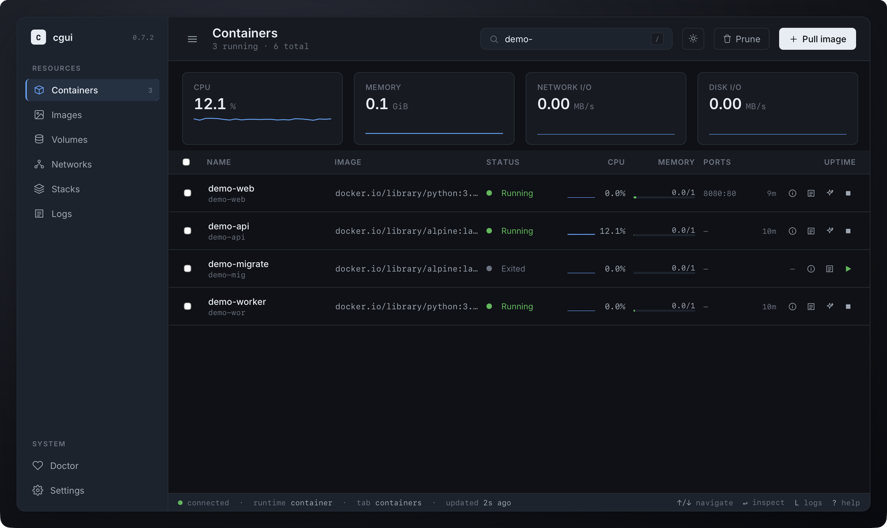
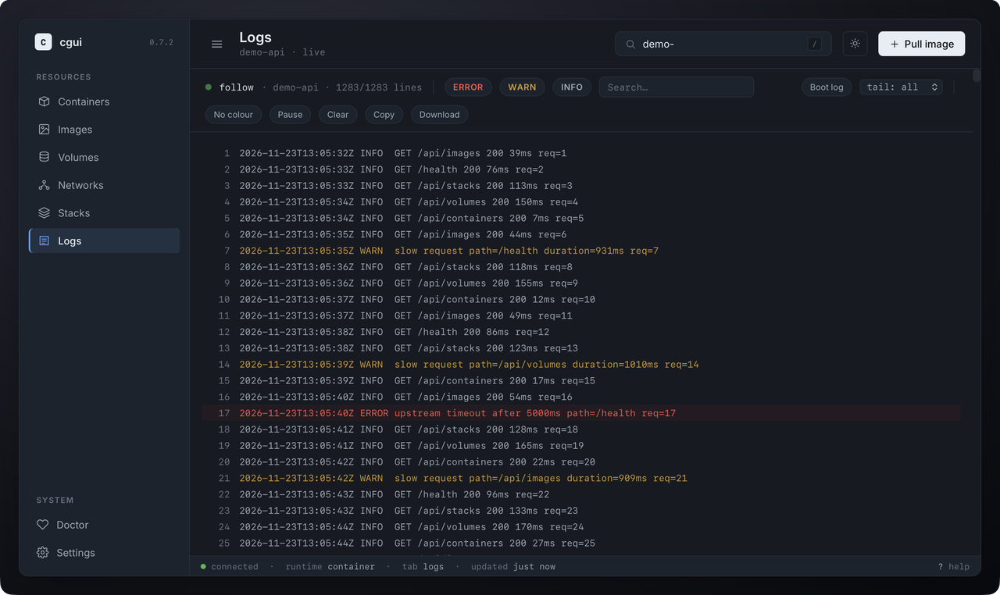
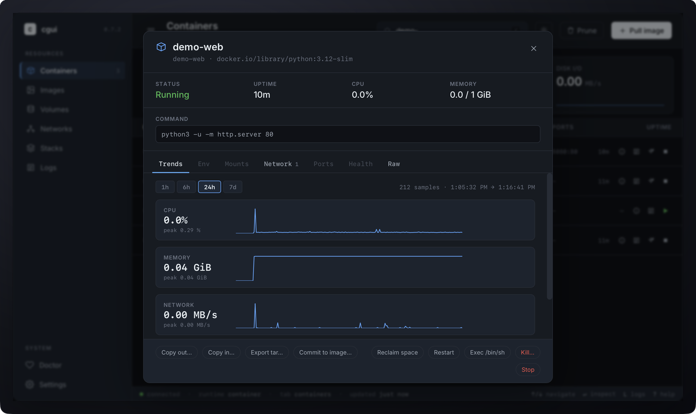
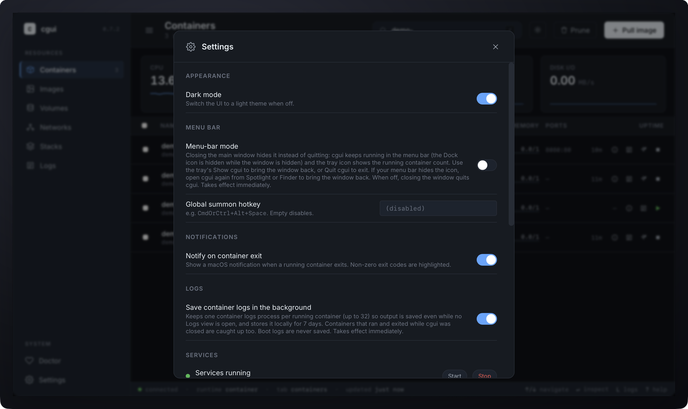
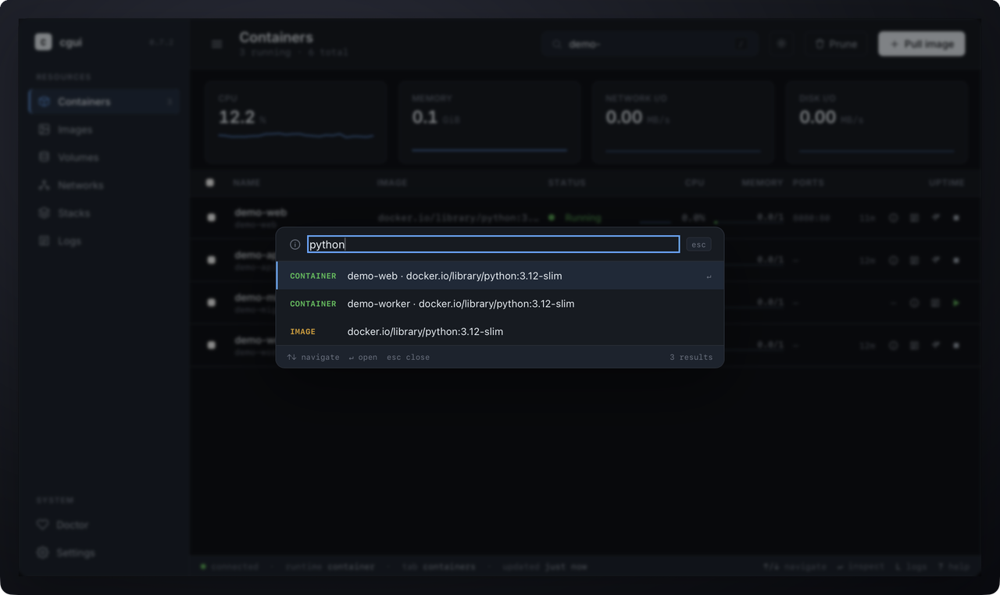

<h1 align="center">cgui-visual</h1>

<p align="center">
  <strong>Desktop GUI for Apple's <a href="https://github.com/apple/container"><code>container</code></a> runtime.</strong><br/>
  Tauri 2 · React · TypeScript · macOS only.
</p>

<p align="center">
  <a href="https://github.com/elementalcollision/cgui-visual/actions/workflows/ci.yml"></a>
  <a href="https://github.com/elementalcollision/cgui-visual/releases/latest"></a>
  <a href="./LICENSE"></a>
  
  <a href="https://tauri.app"></a>
</p>

<p align="center">
  
</p>

<p align="center">
  The visual companion to the <a href="https://github.com/elementalcollision/cgui"><code>cgui</code></a> ratatui TUI — same workflows, different surface.
</p>

<table>
  <tr>
    <td width="50%"></td>
    <td width="50%"></td>
  </tr>
  <tr>
    <td align="center"><sub><b>Logs</b>: live, colour-coded by level, with history kept across restarts</sub></td>
    <td align="center"><sub><b>Container details</b>: trends, network and DNS aliases, terminal, commit to image</sub></td>
  </tr>
  <tr>
    <td width="50%"></td>
    <td width="50%"></td>
  </tr>
  <tr>
    <td align="center"><sub><b>Settings</b>: background log saving, menu-bar mode, notifications</sub></td>
    <td align="center"><sub><b>Command palette</b>: <code>⌘K</code> jumps to any view, container, image or stack</sub></td>
  </tr>
</table>

> **Looking for the TUI?** It lives in [elementalcollision/cgui](https://github.com/elementalcollision/cgui).

## How it compares

cgui-visual targets a specific niche: **devs on Apple Silicon who want a GUI for Apple's first-party `container` runtime**, MIT-licensed, with no commercial license to manage and no Linux VM to feed memory to.

|                          | **cgui-visual**                | Docker Desktop                   | OrbStack            | Podman Desktop      | Lazydocker         |
| ------------------------ | ------------------------------ | -------------------------------- | ------------------- | ------------------- | ------------------ |
| **License**              | MIT — free for any use         | Free for personal; paid for biz  | Paid (free trial)   | Apache-2.0          | MIT                |
| **Platforms**            | macOS                          | macOS · Windows · Linux          | macOS               | macOS · Windows · Linux | macOS · Windows · Linux |
| **Backing runtime**      | Apple `container`              | Docker Engine                    | OrbStack engine     | Podman              | Docker             |
| **Surface**              | Native desktop GUI             | Native desktop GUI               | Native desktop GUI  | Native desktop GUI  | Terminal (TUI)     |
| **Compose-style stacks** | TOML stacks · `docker-compose.yml` import and export | `docker-compose.yml`       | `docker-compose.yml`| Compose plugin      | View-only          |
| **Image vuln scanning**  | Trivy (`brew install trivy`)   | Snyk (paid tier)                 | —                   | —                   | —                  |
| **Bundle size on disk**  | ~10 MB                         | ~1 GB (incl. engine)             | ~600 MB             | ~400 MB             | ~10 MB             |

**TL;DR by audience:**
- **You're already using `cgui` (TUI)** → cgui-visual is the visual companion. Same stacks, same workflows, same `~/.config/cgui/`.
- **Coming from Docker Desktop** → cgui-visual is one of the lightest exits, but you'll be on Apple's `container` runtime instead of Docker Engine. Import your `docker-compose.yml` as a stack.
- **Considering OrbStack** → OrbStack is more polished and cross-runtime; cgui-visual is free, OSS, and laser-focused on Apple's runtime.
- **You like terminal-first tooling** → use [`cgui`](https://github.com/elementalcollision/cgui) (TUI) directly; cgui-visual is for when you want a GUI alongside it.

## What it does

cgui-visual drives Apple's `container` CLI and nothing else (Docker and Podman are not supported). It shells out to the CLI, so anything you do here you could also do in a terminal.

- **Containers** — list / inspect / start / stop / restart / kill / delete, with live CPU, memory, network and disk rates. CPU uses the CLI's native `cpuUtilization` when it reports one (container 1.7.1+) and falls back to deltas of `container stats` on older versions
- **Commit to image** — turn a container into an image from its detail pane (container 1.6+)
- **Images** — list / inspect (with a layer-history view) / Trivy scan / run / tag / push / save / load / delete. The run form covers name, ports, env and a quote-aware command, plus DNS aliases on the chosen network (container 1.6+). Unreadable images (container 1.6+) are skipped with a warning banner instead of failing the list
- **Build** — Dockerfile builds with streamed output, plus builder VM start / stop / delete in Settings
- **Volumes / Networks** — list with reference counts, JSON inspect, delete, and create from the UI (size and labels for volumes; subnets and labels for networks) with inline validation
- **Stacks** — TOML compose-style at `~/.config/cgui/stacks/*.toml`; up/down with topological ordering; live TCP/HTTP/cmd healthchecks with `start_period_s` grace window; per-network DNS aliases; import a `docker-compose.yml`, or export a stack back to one
- **Terminal and trends** — interactive shell into a container; CPU / memory / network / disk history
- **Machines** — list, create (including user options on container 1.6+), stop, delete, set default, plus per-machine logs (stdio or boot log) and inspect
- **Registry, prune, disk usage** — registry logins, prune for containers / images / volumes / networks, and `system df`
- **Logs** — streaming `container logs -f` with a 5 000-line ring buffer and free-text search. Lines are colour-coded by level, and the ERROR / WARN filter understands bracketed tags, plain `ERROR` / `WARN` words, `level=error` fields, JSON `"level"` / `"severity"` keys, Python `ERROR:` prefixes and klog-style lines. The header says when a stream has ended, and why (container stopped or removed)
- **Log history that outlives the container** — `container` keeps only a container's current run: a restart wipes earlier output and deleting the container removes its log. cgui saves the log of every running container in the background (up to 32 at once), whether or not a Logs view is open, and fills in lines written while cgui was closed, without gaps or duplicates. History stays on your Mac for 7 days; turn it off in Settings → Logs
- **Pull** — streaming `container image pull` with progress
- **Doctor** — local-environment health check, including minimum-version and CLI/server version-mismatch checks with one-click service start / restart, and how many containers' logs are being saved
- **Command palette and menu-bar mode** — `⌘K` jumps to any tab, container, image or stack; an optional menu-bar mode keeps the app running with the window closed
- **Accessibility** — dialogs are labelled, trap focus and close on Esc; icon buttons carry accessible names; toggles are real switches; toasts are announced to screen readers; container rows are reachable and operable from the keyboard
- **Self-update** — Tauri-updater plugin against a GitHub-Pages-hosted manifest

### Privacy and network use

Fonts (Inter, JetBrains Mono) ship inside the app and the Content Security Policy only allows the app's own origin. cgui-visual itself makes no network calls except the update checks (GitHub releases and the update manifest) and any HTTP healthchecks you configure on a stack. Pulling images and Trivy's vulnerability-database refresh are done by `container` and `trivy`, not by this app. Saved log history and resource trends stay in a local database (`~/.config/cgui-gui/history.db`) and are never uploaded.

## Compatibility

Requires Apple `container` **1.4.1 or later** (Doctor flags anything older). Tested with 1.4.1 and 1.7.1 on macOS 26.7 and macOS 27.2.

Some features need a newer CLI and are disabled, with an explanatory tooltip, when the detected version is too old:

| Feature | Needs `container` |
| --- | --- |
| Commit container to image | 1.6+ |
| DNS aliases (Run dialog, stacks) | 1.6+ |
| Machine user options | 1.6+ |
| Native CPU utilization (otherwise computed from deltas) | 1.7.1+ |

Unreadable-image handling (a warning banner instead of a failed list) applies to 1.6+ output.

## Layout

```
.
├── app/                    Tauri + React + TS desktop app  ← start here
│   ├── README.md           Setup, dev workflow, architecture
│   ├── src/                Frontend
│   ├── src-tauri/          Rust backend
│   └── …
├── docs/                   architecture.md, archived notes, screenshots
├── CHANGELOG.md
├── CONTRIBUTING.md
└── LICENSE                 MIT
```

The bulk of the project documentation is in [`app/README.md`](./app/README.md); the module layout is in [`docs/architecture.md`](./docs/architecture.md).

## Install

```sh
brew tap elementalcollision/cgui-visual
brew install --cask cgui-visual
```

Or grab the signed `.dmg` directly from the [latest release](https://github.com/elementalcollision/cgui-visual/releases/latest).

The app auto-updates via the bundled [tauri-plugin-updater](./app/README.md#self-update) — no manual brew upgrade needed once installed.

You'll also need Apple's `container` runtime; the app's first-run dialog walks you through installing it.

## Quickstart (development)

```sh
cd app
npm install
npm run tauri dev
```

Apple's `container` CLI is optional during development — when absent, the app falls back to
fixture data so the UI is fully usable for design work.

## License

MIT — see [LICENSE](./LICENSE).
