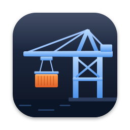

# Quayside brand

cgui-visual will be renamed **Quayside** at the next major release. The
app's current icon (`app/src-tauri/icons/icon.source.svg`) stays until then.

| File | What it is |
| --- | --- |
| `quayside-icon.svg` | Source. A ship-to-shore dock crane in the app's blue, lifting an orange shipping container, on a navy plate. |
| `quayside-icon-1024.png` | 1024 × 1024 render, the input for `tauri icon`. |
| `quayside-icon-256.png` | Preview. |

## Notes for the rename

- The icon follows Apple's macOS grid: an 824 px rounded square
  (corner radius 185) centred on a 1024 px canvas, with a soft drop shadow.
  The current icon fills the whole canvas, so it looks oversized in the Dock.
- To use it, replace `app/src-tauri/icons/icon.source.svg` with
  `quayside-icon.svg` and run `npm run icons` in `app/`.
- Colours: plate `#24324D` → `#0D1422`; crane `#B9DAFF` → `#4C93EC`
  (the in-app accent is `#58A6FF`); container `#FF9F4A` → `#E0612A`.
- At 32 px and below the stays and bracing blur together. If the Finder-list
  sizes need to be sharper, draw a simplified 16 and 32 px version (boom, legs
  and container only).
- Names checked on 2026-11-23: "Gantry" is taken by getgantry/gantry, a Docker
  manager for macOS, and Berth, Derrick, Stevedore and Bollard are used by
  container tools. "Quayside" had no clash among container tools, no Homebrew
  cask, and no repo under elementalcollision.

## Rename checklist

### Step 1: bridge release (0.7.4)

The updater's address is a GitHub Pages URL, and Pages URLs follow the
repository's name. GitHub redirects git and release-download links after a
rename, but not Pages. 0.7.4 therefore lists two updater addresses in
`app/src-tauri/tauri.conf.json`: the current `…/cgui-visual/updates/latest.json`,
then `…/quayside/updates/latest.json`. tauri-plugin-updater tries them in order
and moves on when one fails (checked in 2.14.1: a non-success status or a
network error goes on to the next address; only a 200 that isn't JSON stops
it). A test in `updates.rs` pins both addresses.

Leave a few weeks between 0.7.4 and the rename, so copies in use update
themselves. Copies still older than 0.7.4 at rename time stop seeing updates
and need a manual reinstall. The release-file `latest.json` (the
`releases/latest/download/` link) can't serve as a fallback: its download
links are GitHub API asset URLs, which return metadata rather than the update.

### Step 2: the rename release (next major)

1. Rename the repository `cgui-visual` → `quayside`. Never create a new
   repository called `cgui-visual` afterwards: that would break GitHub's
   redirects.
2. Check that Pages now serves `…/quayside/updates/latest.json` and that the
   old address returns 404 (re-run `updater-manifest.yml` if needed).
3. In the app:
   - `productName` and window title → Quayside;
   - the Dock icon from `quayside-icon.svg` (`npm run icons`);
   - the in-app logo;
   - a one-colour crane template image for the menu-bar icon;
   - "cgui" in visible text (Doctor, notifications, About).
   Keep the bundle id `dev.cgui.gui` and the config folders `~/.config/cgui`
   and `~/.config/cgui-gui`, so settings, log history and macOS permissions
   carry over.
4. Homebrew:
   - rename the tap `homebrew-cgui-visual` → `homebrew-quayside`;
   - rename the cask `cgui-visual` → `quayside`, with a `cask_renames.json`
     entry so `brew upgrade` migrates;
   - update `tap-bump.yml`.
5. Update the README, the docs, the badges and the update address in
   `app/README.md`. Once every copy in use is past 0.7.4, the old address can
   be dropped from the updater list.
6. Test on rename day before announcing: a 0.7.4 install must find the
   rename release through the second address.

### Open decisions

- **The app's file name after an in-app update.** The updater replaces the
  bundle's contents but keeps its path, so in-app updaters keep
  `/Applications/cgui.app`: the menus say Quayside, but Finder, Spotlight and
  Launchpad list "cgui". Either the app renames its own bundle on first
  launch after the update, or the mismatch is accepted and documented.
  Homebrew users get the new name through the cask migration.
- **The `cgui` TUI** (elementalcollision/cgui): rename it too, or keep it
  as is.
